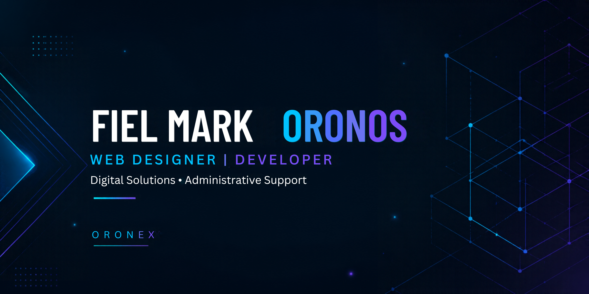

<!-- ORONEX | GitHub Profile README -->
<!-- If your banner filename differs, edit only the image src below. -->

  

<h2 align="center">Hey, I'm Fiel Mark! 👋</h2>

<strong>Web Developer & Designer</strong> · Digital Solutions · Administrative Support

  
  

  
  
  

---

### ✨ A little about me

I'm a Computer Science student in the Philippines who enjoys turning ideas into **responsive websites, practical web applications, and thoughtful digital experiences**. I've worked on business website customization, academic management software, mobile journaling, and administrative spreadsheet workflows.

I care about **clear interfaces, reliable functionality, and learning through real builds**. I use AI-assisted tools where helpful, while reviewing and testing the results.

> **Currently interested in:** freelance website projects, frontend work, website maintenance, and remote digital operations roles.

### 🧰 Tools I work with

**Frontend & web**

    

**Applications, backend & data**

     

**Workflow & design**

    

### 🚀 Selected projects

<table>
<tr>
<td width="50%" valign="top">

#### 🏫 SBAA School Management Portal
A role-based school portal developed as an **academic team project**, with frontend, backend, and database workflows for administrators, faculty, and students.

**Stack:** Vue.js · Node.js · Express · MySQL

**Status:** Development and pilot preparation; not a production school deployment.

[**Explore project →**](https://github.com/oronex-dev/sbaa-school-management)

</td>
<td width="50%" valign="top">

#### 📓 Mindful Journal
A personal Flutter application for writing, mood check-ins, customizable journaling, and locally stored entries.

**Stack:** Flutter · Dart · Local persistence

**Status:** Android build and web experience; consult the repository for platform validation notes.

[**Explore project →**](https://github.com/oronex-dev/mindful-journal-flutter)

</td>
</tr>
<tr>
<td width="50%" valign="top">

#### 🌐 Personal Portfolio
The responsive portfolio website that introduces my work, skills, projects, and contact details.

**Stack:** HTML · CSS · JavaScript

[**Live website →**](https://oronex-dev.github.io/portfolio-fiel-mark/) · [**Source →**](https://github.com/oronex-dev/portfolio-fiel-mark)

</td>
<td width="50%" valign="top">

#### 🛠️ Business website work
Website layout and content customization experience for HiCOOL, using Squarespace and frontend design tools.

**Focus:** Responsive sections · Product presentation · UI refinement

*Public case study and client-approved visuals to be added when ready.*

</td>
</tr>
</table>

### 🤝 Let's build something useful

Whether you need a **responsive landing page**, **website updates**, or help organizing digital workflows, I'm open to discussing a well-defined project.

  
  

ORONEX · Design thoughtfully. Build responsibly. Keep improving.

